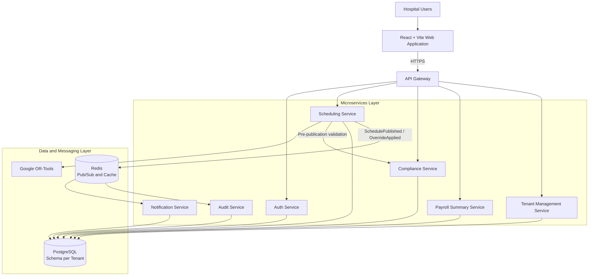

# ShiftOps — Hospital Workforce Scheduling & Compliance Platform

**ShiftOps** is a proposed multi-tenant Software-as-a-Service (SaaS) platform designed to simplify hospital workforce scheduling, automate shift allocation, enforce labor compliance, and maintain accountability through comprehensive audit logging.

Built around a **microservices architecture**, ShiftOps is designed to help hospitals maintain adequate staffing coverage, manage employee availability and leave, generate optimized shift schedules, and handle emergency staffing overrides through controlled authorization and audit trails.

## Table of Contents

- [Overview](#overview)
- [Key Features](#key-features)
- [User Roles](#user-roles)
- [System Architecture](#system-architecture)
- [Microservices](#microservices)
- [Scheduling and Compliance](#scheduling-and-compliance)
- [Emergency Override Workflow](#emergency-override-workflow)
- [Technology Stack](#technology-stack)
- [Quality Attributes](#quality-attributes)
- [Project Scope](#project-scope)
- [Academic Information](#academic-information)

## Overview

Hospital workforce scheduling is a complex task involving staff availability, shift coverage, working-hour limits, rest periods, leave requests, and regulatory requirements. Manual scheduling can lead to staffing gaps, scheduling conflicts, and compliance violations.

ShiftOps addresses these challenges through an architecture designed around:

- Automated shift generation using constraint optimization.
- Centralized compliance validation before schedule publication.
- Secure access through authentication and role-based authorization.
- Hospital-level data isolation in a multi-tenant environment.
- Asynchronous notifications and audit logging.
- Independent deployment and scaling of individual services.

The platform follows a **hard-constraint and soft-constraint model** to balance regulatory compliance, operational flexibility, and patient safety.

## Key Features

- **Automated Shift Scheduling:** Generate optimized staff schedules using Google OR-Tools constraint optimization.
- **Compliance Validation:** Validate proposed schedules against configured working-hour, rest-period, leave, and staffing rules.
- **Emergency Override Management:** Support authorized overrides of eligible soft constraints with mandatory justification.
- **Multi-Tenant Architecture:** Isolate hospital data using separate PostgreSQL schemas for each tenant.
- **Role-Based Access Control:** Provide role-specific permissions for administrators, managers, staff, and auditors.
- **Real-Time Notifications:** Notify affected staff when schedules are published or assignments change.
- **Immutable Audit Trail:** Record important system activities, compliance violations, and emergency overrides.
- **Payroll Summary Export:** Prepare structured JSON or CSV summaries for integration with existing payroll systems.
- **Independent Service Deployment:** Allow individual services to be updated without requiring a full-system redeployment.
- **Scalable Infrastructure:** Support independent resource allocation, background processing, caching, and fault recovery.

## User Roles

| Role | Responsibilities |
|---|---|
| HR Administrator | Manage staff records, approve leave, configure compliance rules, and authorize emergency overrides. |
| Department Manager | Generate and publish schedules, monitor staffing coverage, and request emergency overrides. |
| Staff Member | View personal schedules, submit availability and leave requests, and acknowledge assignments. |
| Compliance Auditor | Review compliance reports, inspect audit trails, and export regulatory documentation. |

## System Architecture

ShiftOps follows a **microservices architecture** consisting of seven independently deployable business services, supported by an API Gateway, PostgreSQL, and Redis.

The architecture separates client interactions, business logic, and persistent data to improve maintainability, availability, scalability, and deployment flexibility.

### Architecture Diagram

*Note: This diagram represents the proposed architecture described in the Software Architecture report.*

### Communication Model

ShiftOps uses two communication approaches:

- **Synchronous REST APIs:** Used for authentication, schedule requests, compliance validation, and other operations requiring immediate responses.
- **Asynchronous Redis Pub/Sub:** Used for event-driven activities such as staff notifications and audit processing.

This hybrid approach is intended to keep critical user-facing operations responsive while allowing background tasks to run independently.

## Microservices

| Service | Primary Responsibility |
|---|---|
| API Gateway | Central entry point, request routing, JWT validation coordination, tenant context propagation, and rate limiting. |
| Auth Service | Authentication, JWT issuance and validation, user management, and role-based authorization. |
| Scheduling Service | Shift generation, schedule management, optimization, and publication. |
| Compliance Service | Validate schedules against hard and soft constraints and authorize eligible override workflows. |
| Notification Service | Process scheduling events and dispatch in-app and email notifications. |
| Payroll Summary Service | Aggregate shift records, calculate relevant hour summaries, and export JSON or CSV data. |
| Audit Service | Maintain audit records for scheduling, authentication, compliance, and override events. |
| Tenant Management Service | Provision hospital tenants, create isolated database schemas, and initialize tenant configuration. |

*The API Gateway is the shared entry point; the seven business services are the core microservices.*

## Scheduling and Compliance

The scheduling workflow is designed to ensure that a proposed schedule is validated before publication.

1. A department manager submits a schedule-generation request.
2. The Scheduling Service sends the scheduling constraints to the OR-Tools optimization engine.
3. The engine generates an optimized draft schedule.
4. The Scheduling Service requests validation from the Compliance Service.
5. The Compliance Service evaluates the proposed schedule and returns an appropriate result.
6. The Scheduling Service publishes the schedule only after receiving a `PASS` response or completing an authorized, eligible override workflow.
7. The system emits events for notification delivery and audit processing.

### Constraint Model

**Hard constraints**

Hard constraints cannot be overridden. Examples include:

- Preventing double-booking.
- Preventing assignments during approved leave.
- Maintaining required minimum staffing coverage.

**Soft constraints**

Soft constraints are normally enforced but may be overridden through the designated authorization process. Examples in the report include:

- Weekly working-hour limits.
- Minimum rest periods between shifts.
- Maximum consecutive working days.

The Compliance Service distinguishes these outcomes:

| Result | Meaning |
|---|---|
| `PASS` | The proposed schedule satisfies the configured constraints. |
| `SOFT_VIOLATION` | An eligible constraint has been violated and an authorized override may be requested. |
| `HARD_VIOLATION` | A non-overridable constraint has been violated; the operation is blocked. |

## Emergency Override Workflow

Emergency staffing requirements may sometimes require an exception to an eligible soft constraint. ShiftOps is designed to support this through an accountable, role-controlled workflow.

1. The proposed schedule is checked by the Compliance Service.
2. A soft-constraint violation is identified and returned with its details.
3. An authorized user reviews the violation.
4. The user provides a mandatory justification and incident reference.
5. The authorization is verified before the override is applied.
6. An `OverrideApplied` event is published for audit processing and notification.
7. The Audit Service records the authorizing user, timestamp, violated rule, justification, and incident reference.

Hard constraints remain non-overridable.

## Technology Stack

The proposed architecture uses the following technologies:

| Technology | Purpose |
|---|---|
| React | Hospital staff web interface. |
| Vite | Frontend development and build tooling. |
| Node.js and Express | API Gateway and most business microservices. |
| Python | Scheduling optimization service. |
| Google OR-Tools | Constraint-based schedule optimization. |
| PostgreSQL | Persistent storage and tenant-level schema isolation. |
| Redis | Asynchronous event messaging and caching. |
| JSON Web Tokens (JWT) | Authentication context and role claims. |
| REST APIs | Synchronous inter-service communication. |
| Docker / Container Orchestration | Proposed service isolation, deployment, and recovery. |

## Quality Attributes

The architecture is evaluated against the following software quality attributes:

- **Availability:** Independent service failure domains, health checks, automatic restarts, redundant instances, and graceful degradation.
- **Deployability:** Independent service releases, API versioning, blue-green deployments, and rollback support.
- **Scalability:** Independent scaling for scheduling, notification delivery, and other workloads.
- **Performance:** Cached compliance results, read-replica support, and asynchronous background processing.
- **Security and Confidentiality:** JWT-based authentication, role-scoped authorization, tenant isolation, and auditable overrides.
- **Maintainability:** Clear service boundaries and well-defined inter-service contracts.
- **Energy Efficiency:** Off-peak batch scheduling, elastic scaling, caching, and shared infrastructure.
- **Testability:** Isolated service tests, contract tests, event-consumer tests, and end-to-end workflow testing.

## Project Scope

This project focuses on **software architecture analysis and the design of a hospital workforce scheduling platform**. It documents architectural decisions, quality-attribute scenarios, trade-offs, service responsibilities, and end-to-end workflows.

The proposed design uses a microservices pattern because it supports the project's central architectural goals: service-level fault isolation, independent compliance updates, tenant isolation, and independent scaling of computationally expensive scheduling tasks.

Implementation status, deployment configuration, and measured performance should be verified against the actual source code and deployment environment.

## Academic Information

**Course:** Software Architecture  
**Course Code:** CSE 4435  
**Section:** A  

**Submitted By:**
- Md. Mahin Khan — 0112230105
- Md. Asaduzzaman — 0112230091
- Md. Noman Hossain — 011222159

**Submitted To:** Tanmoy Bipro Das, Lecturer, Department of CSE

---

*ShiftOps — Designing reliable, scalable, and compliant hospital workforce scheduling through microservices architecture.*
